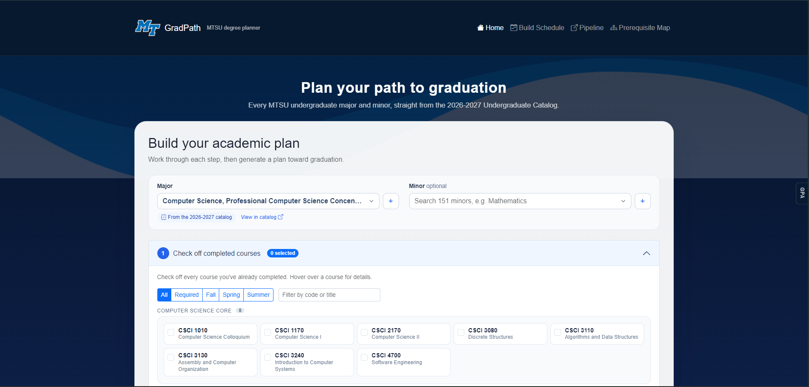
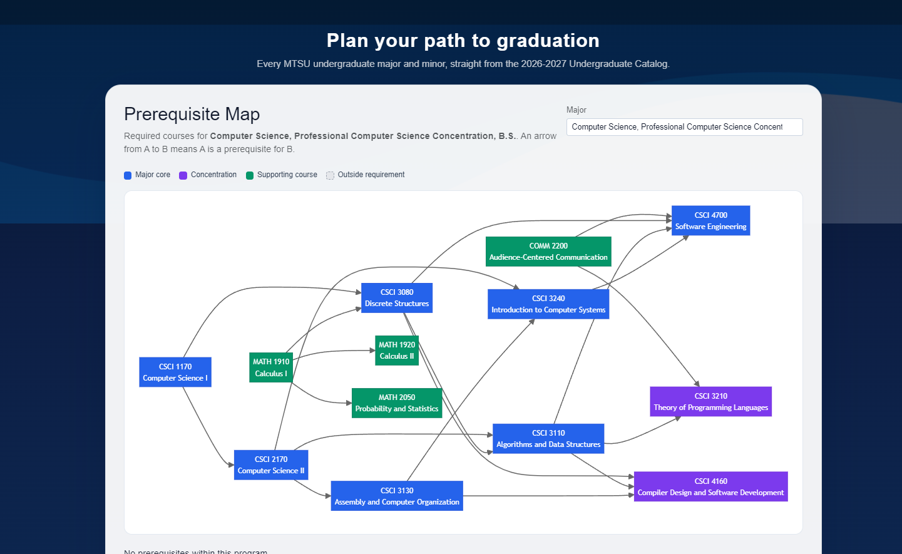
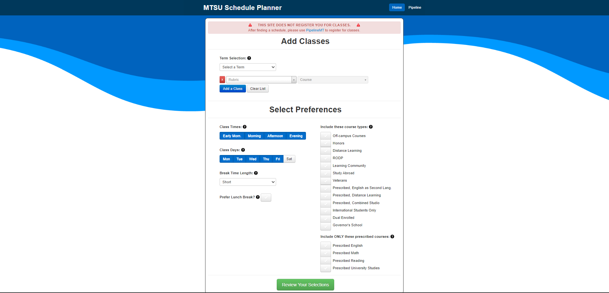
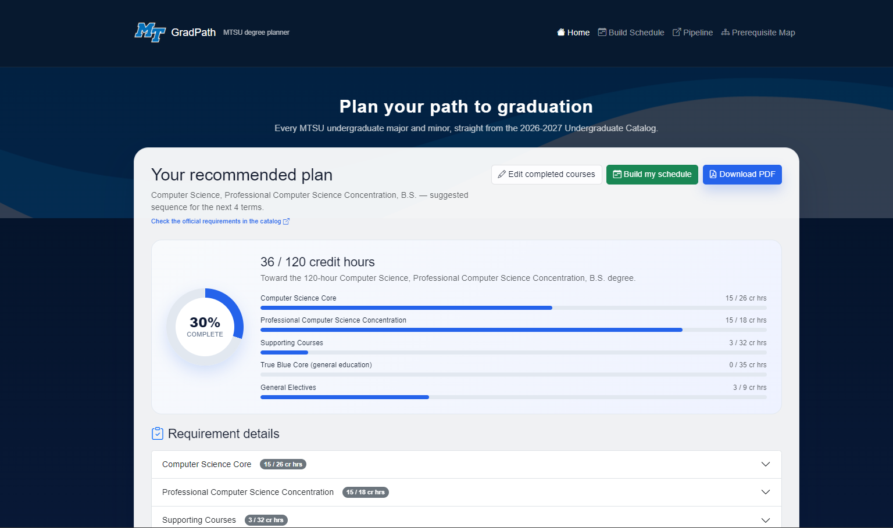
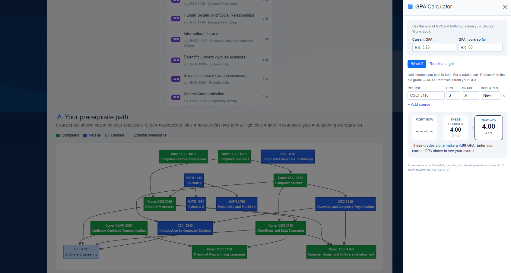
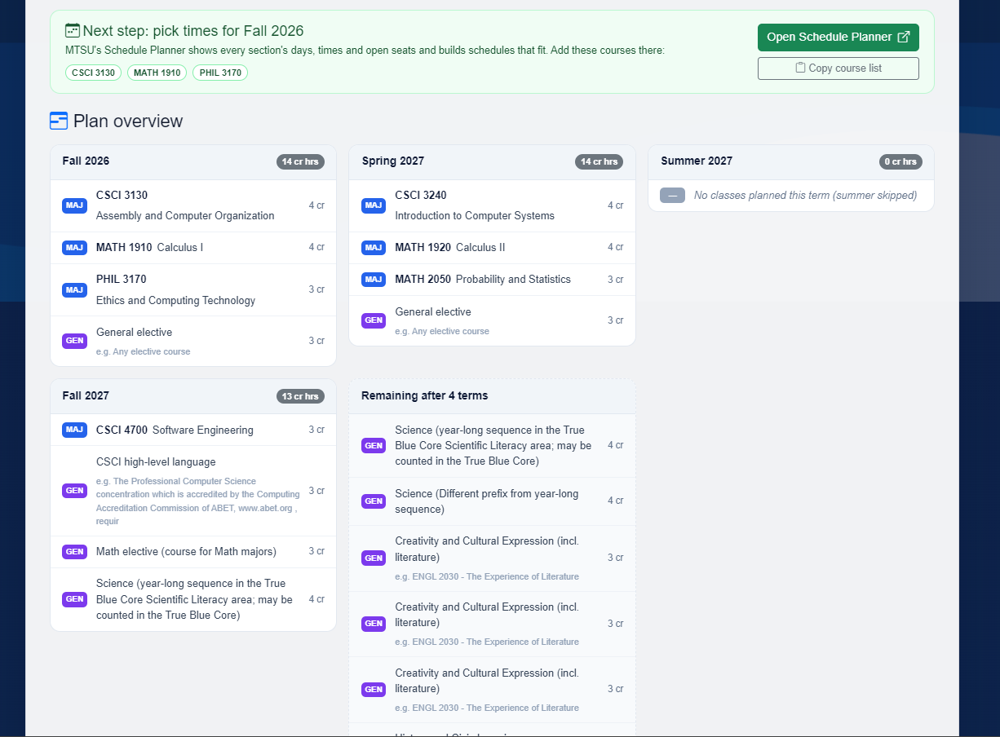
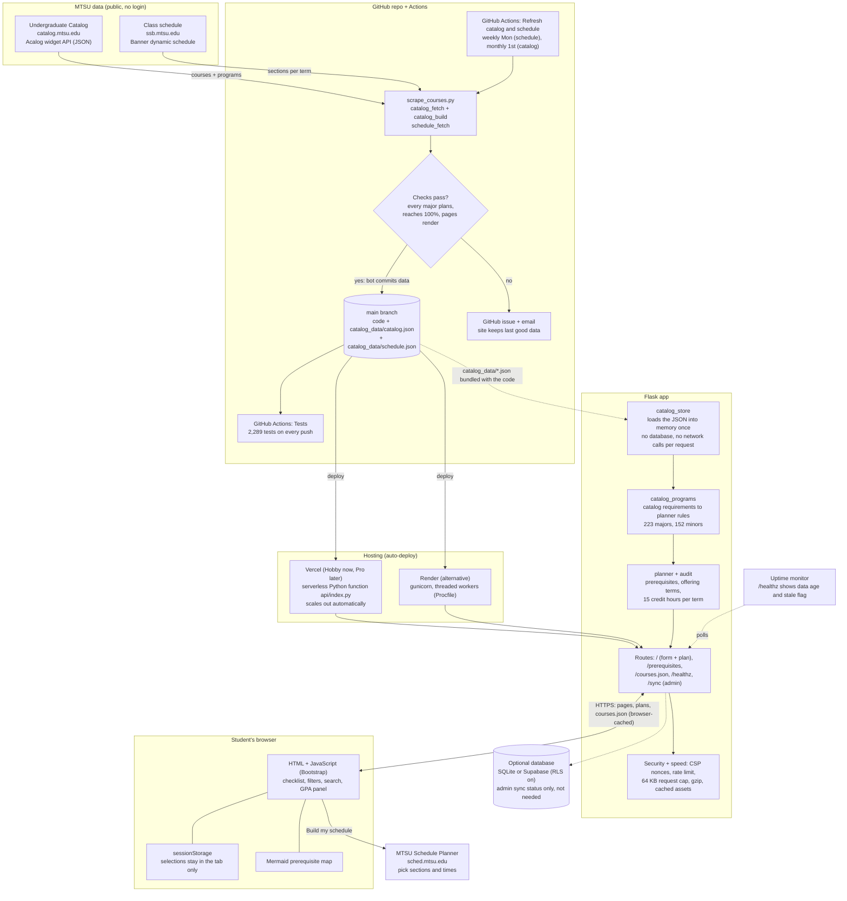
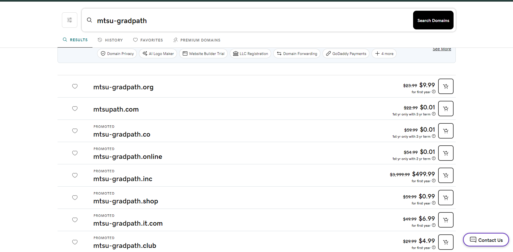

# MTSU GradPath

A degree-progress and term-planning tool for MTSU undergraduates. Pick a major (and optionally a second major or minors), check off what you've taken, and GradPath audits your progress and builds a term-by-term plan that respects prerequisites.

**Every undergraduate major and minor in the 2026-2027 MTSU catalog is supported** — 223 majors and concentrations, 152 minors, and 3,475 courses — read straight from MTSU's official catalog data rather than hand-coded.

### Data sources

| What | Pulled from | Refreshed automatically |
|---|---|---|
| Courses, majors, minors, concentrations and their requirements | MTSU Undergraduate Catalog — **https://catalog.mtsu.edu** (via its public Acalog widget API, `https://catalog.mtsu.edu/widget-api/`) | Monthly (1st of the month) |
| Which terms each course is offered (fall / spring / summer, alternate years, posted future terms) | MTSU class schedule — **https://ssb.mtsu.edu/pls/PROD/bwckschd.p_disp_dyn_sched** (public, no login; same data as RaiderNet's class lookup) | Weekly (Mondays) |

Picking actual sections (days, times, open seats) is handed off to MTSU's own Schedule Planner at **https://sched.mtsu.edu/#/form** via the *Build my schedule* button.

Live demo: **https://mtsu-gradpath.onrender.com**
Video walkthrough: **https://youtu.be/ePZ4cazj3Gw** 


### Screenshots

| | |
|---|---|
|  |  |
| **1. Planner** — pick a major (and optional second major or minors), check off completed courses, filter by *Required / Fall / Spring / Summer*, hover any course for details. | **2. Prerequisite map** — every required course for the major; an arrow from A to B means A unlocks B. |
|  |  |
| **3. Build my schedule** — hands off to MTSU's own Schedule Planner (`sched.mtsu.edu`) to pick sections by days, times and open seats. | **4. Results** — percent complete, credit hours by requirement section, and buttons to edit, build a schedule, or download a PDF. |
|  |  |
| **5. GPA calculator** — side panel for "what if" grades and reaching a target GPA, next to the student's personal prerequisite path. | **6. Term-by-term plan** — courses placed by prerequisites and the terms MTSU actually offers them; the next term's courses are ready to copy into the Schedule Planner. |

---

## Installation

1. Create a virtual environment and install dependencies:

   **Linux / macOS**
   ```bash
   python3 -m venv .venv && source .venv/bin/activate
   pip install -r requirements-dev.txt
   ```
   **Windows (PowerShell)**
   ```powershell
   python -m venv .venv; .venv\Scripts\Activate.ps1
   pip install -r requirements-dev.txt
   ```
   (`requirements-dev.txt` = the production `requirements.txt` plus pytest.)

2. Set a `SECRET_KEY` — **required**, `app.py` reads it via `os.environ["SECRET_KEY"]` and will not start without it:

   ```bash
   cp .env.example .env
   # edit .env and set SECRET_KEY to the output of:
   python -c "import secrets; print(secrets.token_hex(32))"
   ```

3. Run it and open `http://127.0.0.1:5000`. Course and program data ship with the repo (`catalog_data/catalog.json`), so there's no sync step:

   ```bash
   python app.py
   ```

### Running on JupyterHub

1. Upload/clone this folder into your JupyterHub home directory.
2. Open a **Terminal** (not a notebook cell) and follow steps 1–3 above exactly as on Linux.
3. JupyterHub doesn't expose `127.0.0.1:5000` directly — use the hub's proxy path instead:
   ```
   https://<your-jupyterhub-domain>/user/<your-username>/proxy/5000/
   ```
   If `jupyter-server-proxy` isn't installed on the hub, ask the instructor for the proxy URL pattern used there.

---

## Where the data comes from

MTSU's online catalog (catalog.mtsu.edu) runs on **Acalog**, which has a public *widget API* — the same one behind the embeddable widget MTSU ITD shared (`data-acalog-data="programs"`). It returns courses and full program requirement trees as JSON, **without an API key**, as long as you use the API's own catalog id:

| Catalog | id in catalog.mtsu.edu URLs (`catoid`) | id in the widget API |
|---|---|---|
| 2026-2027 Undergraduate | 49 | **12** |
| 2025-2026 Undergraduate | 45 | 9 |

Asking the API for catalog 49 returns an error, which is why we originally thought newer catalogs needed a token. They don't — `GET /widget-api/catalogs/` lists every catalog with both ids, and the exporter picks the newest published undergraduate one automatically.

**Export pipeline** (`python scrape_courses.py`):

1. `catalog_fetch.py` downloads every course and program detail (about 3,900 requests and ~40 minutes, throttled to stay under the catalog's firewall; resumable — already-downloaded items are cached in `data/raw_catalog/`).
2. `catalog_build.py` cleans it into `catalog_data/catalog.json`: each course's title, credits, prerequisites (including "A or B" choices, "must be taken concurrently" co-requisites, and minimum grades), and each program's requirement sections in catalog order.
3. The app loads that file once at startup. No scraping, database queries, or network calls happen while students use the site.

**Turning a catalog program into a plan** happens at load time in `catalog_programs.py`:

| Catalog shows | GradPath treats it as |
|---|---|
| A course on its own | Required course, scheduled by prerequisites |
| Courses joined by **OR** | One choice — any completed option counts |
| Lecture **AND** 0-credit lab | Taken together: checking the lecture counts the lab, and the planner schedules them in the same term |
| "Choose five from the following" / more courses than hours | A pool: N hours from the listed courses |
| "CSCI upper-division electives 9 credit hours" | Upper-division electives, filled with real catalog courses |
| An empty "College of Business Core (42 hours)" | Filled from the four-year academic map |
| True Blue Core | The 8 gen-ed areas (41 hrs), minus areas the major's own courses already cover |
| Top-level "Electives" | Free electives — whatever is left of the total |

Requirement rows that list courses (choices, pools, gen-ed areas) **fill in automatically** from the courses a student checks off.

Every major and minor comes from the catalog — nothing is hand-coded. Old short links (`?major=cs`, `chemistry`, `math`, …) resolve to the same program in the catalog.

### When courses are offered

`catalog_data/schedule.json` records which terms each course actually ran, from **MTSU's public class schedule** (`ssb.mtsu.edu/pls/PROD/bwckschd.p_disp_dyn_sched`, no login — the same data as RaiderNet's class lookup). It covers the last three years of Fall/Spring/Summer plus any term already posted (e.g. next spring). One request per term returns every section of every subject, so a refresh is about a dozen requests.

The planner uses it in this order:

1. **A posted term is exact** — a course is planned for Spring 2027 only if Spring 2027's schedule lists a section.
2. **Otherwise, recent history** — never run in a season (two or more chances since the course first appeared) → not planned then; only run in odd (or even) years → planned only then. Courses show tags like *Fall only* or *Odd-year springs* in the checklist and plan.
3. **No history** (a brand-new course) → the team's old notes if any, else fall and spring but not summer.

A required course that only runs in summer gets a plan warning telling the student to turn on summer terms; elective picks skip summer-only courses.

### Keeping it current — automatically

The **Refresh catalog and schedule** GitHub Action (`.github/workflows/refresh-data.yml`):

| When | What |
|---|---|
| Every Monday | Re-download the class schedule |
| 1st of each month | Re-download the full catalog too (new courses, changed majors, a new catalog year) |

Every run first checks that the site works with the new data — every major and minor must still plan without warnings, every major must reach 100% when complete, every page must render — and only then commits it to `main`, which redeploys the site. Tests that pin specific facts ("Accounting requires ACTG 3110") run afterwards: if MTSU changed one of those, the data is still published and an issue asks for the test to be updated, so a real catalog change never blocks the refresh. So if MTSU drops Calculus I from Computer Science, the site stops requiring it within a month, with no code change. If anything fails (MTSU's site is down, or its format changed), **nothing is published**, the site keeps serving its last good data, and the workflow opens a GitHub issue. Refreshes also refuse to publish data that shrank by more than 20% (a sign of a broken download, not a real catalog change).

The weekly run always commits (its timestamp changes), which also stops GitHub from disabling the scheduled workflow for inactivity. `/healthz` reports each file's age and `"stale": true` if the catalog is over 45 days old or the schedule over 21 — point an uptime monitor at it.

**Refreshing by hand** (the workflow does this for you):

```bash
python scrape_courses.py --schedule              # class schedule only (~3 min)
python scrape_courses.py --refresh --schedule-too  # full catalog (~40 min) + schedule
python scrape_courses.py --build-only            # rebuild catalog.json from already-downloaded data
```

---

## Configuration

Read via `mtsugradpath/config.py`, settable in `.env` or as shell env vars:

| Variable | Default | Description |
|---|---|---|
| `SECRET_KEY` | *(required)* | Flask session signing key |
| `DATABASE_URL` | `sqlite:///data/mtsu_courses.db` | Only holds small shared state (catalog re-export status, course equivalencies). Course data is **not** in the database. Production can keep using Supabase Postgres — see `.env.example` |
| `MTSU_CATALOG_URL` | `https://catalog.mtsu.edu` | Catalog site the exporter reads from |
| `GRADPATH_CATALOG_FILE` | *(unset)* | Load a different catalog JSON (testing) |
| `DB_POOL_SIZE` / `DB_MAX_OVERFLOW` | `3` / `2` | SQLAlchemy connection pool size per process |
| `SYNC_ADMIN_USER` / `SYNC_ADMIN_PASSWORD` | *(unset = disabled)* | HTTP Basic Auth for `/sync`, which re-exports the catalog on a running server. Without both set, `/sync` refuses every request |
| `ALLOW_OPEN_SYNC` | *(unset)* | `1` allows `/sync` without credentials — local development only |
| `SESSION_COOKIE_SECURE` | `1` on Render/Vercel, else `0` | Send the session cookie over HTTPS only |
| `FLASK_DEBUG` | *(unset)* | `1` turns on the debugger for `python app.py` (never in production) |
| `WEB_CONCURRENCY` | `3` | Gunicorn worker count (see `Procfile`) |

---

## Recent Changes

- **Plans follow MTSU's own order** — courses are scheduled by the major's four-year map in the catalog (freshman-year courses first, then course level), so *Introduction to Aerospace* comes before *Professional Pilot I*. "Junior/senior standing" prerequisites wait for 60/90 earned hours (MTSU's class standing: sophomore 30, junior 60, senior 90), and "or simultaneous completion of X" corequisites are never planned after the course. With a second major or minor, one program's prerequisite that another program brings (MATH 1730 before MATH 1910) is honored too. All of it is read from the catalog, so it follows MTSU's changes.
- **Full-screen prerequisite map** — the map on the plan page and the Prerequisite Map page have *Full screen*, zoom and *Fit* buttons; drag to move around a large map.
- **Numbered sequences stay in order** — Part II of any sequence (Calculus II, Physics II, Professional Pilot Flight Lab II, Studio II…) is always planned in a later term than Part I, even when the catalog's prerequisite line names a certificate instead of the course ("Private Pilot Certificate"). Found from the catalog's own course titles, so new sequences are picked up automatically; where the catalog says the order doesn't matter ("HIST 1010 is not a prerequisite for HIST 1020") it's left alone.
- **Plans match the catalog pages** — "Choose … from the following" lists partway down a section no longer swallow the required courses above them (Professional Pilot, Pre-Law, Theatre and ~60 other majors), "A, B, or C" prerequisites are read as one choice, and plans fill 8 real semesters (skipped summers don't count) with gen-ed spread through the plan. A *check prereq* tag shows the catalog's wording when a course needs something outside the plan.
- **Tested live on Vercel Hobby** — ~70 ms per page or plan, and 150 simultaneous students all served (2–3 s while it scales up). Free Hobby plan for now; [upgrade to Pro](#when-to-upgrade-to-pro) when usage or official adoption calls for it.
- **Automatic refresh confirmed** — the first scheduled-style run downloaded MTSU's class schedule, passed its checks, and published the new data to both Render and Vercel with no one touching it.
- **Schedule Planner hand-off** — *Build my schedule* opens MTSU's Schedule Planner with the next term's courses ready to copy, to pick sections by time, days and open seats.
- **Checklist filters and hover details** — filter by All / Required / Fall / Spring / Summer or text; hovering a course shows credits, offering terms, required status and minimum grade.
- **Hands-off refresh hardened** — a real catalog change can't block the automatic refresh, old links follow renamed programs, and an unreachable database is no longer retried on every request.
- **Supabase locked down** — the app enables Row-Level Security on every table at startup (Supabase's public API can't read or change them).
- **Real offering terms for every course** — from MTSU's public class schedule: fall-only, no-summer, and alternate-year courses are planned only when they actually run, and posted future terms are used exactly. Courses are tagged *Fall only*, *Odd-year springs*, etc.
- **Self-updating** — every major comes from the catalog (the five hand-coded ones are retired; old links still work), and a GitHub Action refreshes the schedule weekly and the catalog monthly, publishing only after the full test suite passes.
- **Every selection counts** — courses beyond a full requirement count toward free electives instead of disappearing; hours typed in step 3 always show in the audit.
- **Every major and minor, from the official catalog** — requirements now come from MTSU's Acalog catalog data instead of hand-written configs, taking GradPath from 8 majors and 1 minor to 223 majors/concentrations and 152 minors. Each program links to its official catalog page.
- **Fast, no sync step** — the catalog ships as a JSON file loaded into memory at startup (about a quarter second). Pages render in about 4 ms on the server and are gzipped (the planner page went from ~160 KB to ~30 KB); nothing waits on the catalog website or the database. The public "Sync Catalog" button is gone.
- **Choices and gen-ed fill themselves in** — "Choose one: MATH 1530 or BIA 2610" rows and True Blue Core areas are credited from the courses a student checks off, so far fewer hours need typing in.
- **Course search covers the whole catalog** — served as a cached `/courses.json` so the planner page itself stays small.
- **Prerequisite Map for any major** — `/prerequisites?major=<key>` with a major picker.
- **Smarter prerequisites** — "A or B" prerequisites resolve to whichever option the student took or the program requires; "must be taken concurrently" courses are co-requisites; a course checked off without a grade no longer blocks the courses after it.
- **Tests for every program** — the suite plans every catalog major from scratch (and from partial progress) and checks there are no prerequisite violations and nothing gets stuck.

---

## Usage

1. Search for a major in the **Major** box (e.g. "nursing", "accounting", "CSCI"). Optionally add a second major and up to four minors.
2. Check off completed courses, grouped by the catalog's own sections. Hover a course for its credits, when it's offered, whether it's required, and any minimum grade. Filter the list with **All / Required / Fall / Spring / Summer** or by typing a code or title. Use search (step 2) to add anything else in the catalog.
3. Review **Other degree requirements**: rows marked *auto* fill in from checked-off courses; enter hours for anything else.
4. Pick a starting term/year, number of terms, and whether to include summers, then **Generate Plan**.
5. Review completion progress, the per-section breakdown, the term-by-term schedule, and any prerequisite warnings. **View in catalog** links to the official program page.
6. **Build my schedule** (or *Build Schedule* in the nav) opens MTSU's Schedule Planner (`sched.mtsu.edu`) to pick sections by days, times and open seats; the plan page lists the next term's courses with a button to copy them.
6. **Prerequisite Map** in the nav bar shows the course dependency graph for any major.

Selections are kept in the browser tab's `sessionStorage` — nothing is stored server-side.

---

## Testing

```bash
python -m pytest tests
```

### Test results

Everything below passed on the current version (October 2026). The automated suite also runs on every push through GitHub Actions, and the data-refresh workflow re-checks every major before publishing new data.

| What was checked | Scope | Result |
|---|---|---|
| **Automated test suite** (`pytest`) | 2,289 tests | **2,288 passed, 0 failed** (1 skipped by design) |
| Every major planned from scratch — no prerequisite or offering-term violations, every required course scheduled | All 223 majors/concentrations | 223 / 223 |
| Every major's required hours add up to at least its catalog total | All 223 | 223 / 223 |
| **Every major matches its catalog page** — each course a page lists on its own line (not in a "choose" list or an "or") is planned as required, checked with a plain reading independent of the converter | All 223 | 223 / 223 (the same check flags 29 majors on the previous version, e.g. Professional Pilot, Pre-Law, Theatre) |
| Every major planned over 8 semesters — no course in the same term as, or before, a prerequisite on the plan | All 223 | 223 / 223 |
| Numbered sequences (Calculus I → II, Flight Lab I → II, Physics I → II…) always in later terms, from scratch and from random progress | All 223 × 3 plans | 223 / 223 (before the fix: out of order in 18 majors) |
| "Junior/senior standing" prerequisites met and corequisites never planned after the course | All 223 | 223 / 223 (before the fix: standing missed in 76 majors) |
| Plans follow the major's four-year map — nothing the map puts 2+ years earlier lands after a later course, no 1000-level course after a 3000/4000-level one in its subject (unless the map or the offering terms say so) | All 223 from scratch + random students | 223 / 223 (before the fix: out of order in 122 majors) |
| Random students with minors and second majors through the real plan page — prerequisites (including ones another program brings), sequences, class standing, corequisites, map order, nothing twice | 60 in the test suite, plus 9,200 in stress runs | 0 problems (before the fix: about 1 in 120 combined plans had a prerequisite out of order) |
| Saved catalog vs the live catalog (fresh download of 7 programs and the flight-lab courses) | Professional Pilot, Pre-Law, Studio Art, Nursing, Theatre, Interior Architecture, Computer Science | Identical |
| Completing everything reads 100% with nothing left to plan | All 223 | 223 / 223 |
| Every minor planned alongside a major without warnings | All minors (155 incl. cross-listed) | 155 / 155 |
| Plans from random partial progress keep prerequisite order and never re-plan finished courses | 32 majors × 5 random students | All passed |
| Plan page renders without warnings | 45 majors | 45 / 45 |
| Catalog parsing, requirement conversion, offering-term inference, self-updating (e.g. removing Calculus I from CS in the catalog removes it from the site), security headers, input limits | 70+ focused tests | All passed |
| **Randomized fuzzing** — random majors, second majors, minors, completed courses and typed hours | 4,000+ generated plans | 0 crashes, 0 plan warnings, no course planned twice or re-planned after completion, no audit over 100% |
| **Real-browser trials** (headless Chrome clicking through the site) — checklist, typed-in courses, step-3 hours, minors, summers, back-and-forth navigation | 135 sessions, ~100 majors, ~1,070 courses selected, ~210 hour entries | Every selection showed up correctly in *Requirement details*; selections restored on return; 0 JavaScript or security-policy errors |
| **Load test** (gunicorn as in the `Procfile`, 2 CPUs) | Up to 40 simultaneous requests | ~170–200 requests/s, 95% under 0.5 s, 0 errors |
| **Live test on Vercel Hobby** (the free plan the site runs on) — simulated students loading the planner, generating plans, and all arriving at once | 40 page loads and plans at normal pace + 150 simultaneous requests | Pages and plans in **~70 ms** (95% under 120 ms); **150 / 150** simultaneous requests served, with a 2–3 s wait while Vercel scaled up; no crashes |
| Independent code reviews | Correctness review and security/production review | All confirmed findings fixed and covered by tests |

Problems found during this testing (for example, 0-credit labs counted as 3 credits, plans stopping at the first empty term, a course past a full requirement disappearing) were fixed, and each now has a test so it can't come back.

#### What the October 2026 plan-order testing found and fixed

Students flagged Professional Pilot plans with Flight Lab I and II too close together and *Professional Pilot I* before *Introduction to Aerospace*. Testing every major, minor and combination turned up:

| Found | How widespread | Fix |
|---|---|---|
| Plans out of MTSU's order (e.g. a senior seminar in the first semester, an intro course after a 3000-level one) | 122 of 223 majors | Courses follow each major's four-year map in the catalog, then course level |
| "Junior/senior/sophomore standing" prerequisites ignored | 365 courses; 76 majors affected | Waits for 30 / 60 / 90 earned hours (MTSU's class standing) |
| A corequisite ("or simultaneous completion of X") planned after the course | 19 majors | Same term or earlier; the one contradictory catalog link (Interior Architecture) is dropped |
| Part II of a sequence in the same term as Part I (Physics I/II, Studio I/II, Music History I/II) | 18 majors | Part II always a later term, read from course titles |
| With a minor or second major, a prerequisite the other program brings ignored (MATH 1910 before MATH 1730) | About 1 in 120 combined plans | Prerequisites checked against the whole combined plan |

After the fixes: 0 problems in 2,676 random single-major plans and 9,200 random major/minor/double-major plans through the real site, and 0 page errors in browser trials. The heaviest setups (double major + four minors, 16 terms) take a median of 14 ms, at most 86 ms.

**Degree Works:** it needs a student's PipelineMT login, so it couldn't be checked directly. Plans were compared against the live catalog instead (the source Degree Works audits against): 7 programs downloaded fresh matched the saved data exactly. A program-by-program Degree Works comparison is planned (see [next steps](#status-and-next-steps)).

### What the test files cover

- `tests/test_catalog_majors.py` runs against the real exported catalog: every major plans from scratch with no prerequisite or offering warnings and every required course gets scheduled; every major reaches 100% when complete; a sample of majors also plans cleanly from random partial progress; every minor plans alongside CS; every major's page renders; plus spot checks (Accounting matches its catalog page, prerequisite map, course search, health check).
- `tests/test_self_updating.py` proves the site follows MTSU's data: removing Calculus I from CS in the catalog removes it from the site, a new program appears in the picker, a renamed program keeps old links working, offering patterns come from the class schedule, and a shrunken (broken) refresh is refused.
- `tests/test_production.py` covers security headers, input limits, malformed input, Row-Level Security on Supabase tables, an unreachable database, and the admin re-export route.
- `tests/test_catalog_build.py` covers parsing catalog text (prerequisite sentences, OR groups, concurrent courses, minimum grades, credit hours, program sections).
- `tests/test_catalog_programs.py` covers turning catalog sections into planner configs on a small made-up catalog.
- `tests/test_plan_integrity.py`, `test_planner.py`, `test_minors.py`, `test_double_major.py`, `test_form_flow.py`, `test_session_persistence.py`, `test_sync_status.py` cover the planner, audits, double majors/minors, the web form, and session handling.

GitHub Actions runs the suite on every push and pull request.

---

## Architecture

### How everything fits together



**In words:** GitHub Actions downloads MTSU's catalog (monthly) and class schedule (weekly), turns them into two JSON files, checks that every major still plans correctly, and commits them. Every push to `main` redeploys the site on Vercel (and Render). When the app starts, it loads those JSON files into memory, so a student's request never waits on MTSU's servers or a database — pages and plans are built in a few milliseconds and sent to the browser, where selections stay in the tab. Picking actual class sections is handed off to MTSU's Schedule Planner.

### Files

```
app.py                  Flask routes: / (form + plan), /prerequisites, /courses.json, /healthz, /sync (admin)
scrape_courses.py       CLI: export the catalog and class schedule
catalog_data/
├── catalog.json        Exported catalog (courses + programs), committed to the repo
└── schedule.json       Terms each course ran (MTSU class schedule), committed to the repo
mtsugradpath/
├── catalog_fetch.py    Downloads raw courses/programs from the Acalog widget API
├── catalog_build.py    Cleans raw API data into catalog.json
├── catalog_store.py    Loads catalog.json once per process; course lookups, search index
├── schedule_fetch.py   Downloads term-by-term course offerings from MTSU's public class schedule
├── catalog_programs.py Converts catalog programs into planner configs (majors + minors)
├── degree_configs.py   Major registry (catalog majors, old-key aliases) + retired hand-written configs
├── degree.py           Degree audit (by catalog section for catalog majors)
├── minors.py           Catalog minors, minor audit
├── double_major.py     Folding a second major into a plan
├── planner.py          Term scheduling (generate_plan) + independent validation (validate_plan)
├── models.py / db.py   Small shared state (export status, course equivalencies)
└── config.py           Env configuration
templates/, static/     Jinja templates, CSS/assets
tests/                  pytest suite
.github/workflows/      Tests on push; weekly schedule + monthly catalog refresh
```

**Scheduling:** `generate_plan()` fills each term toward 15 credit hours: required major/concentration courses first, then supporting courses, then requirement rows (choices, pools, gen-ed, free electives) — all gated by prerequisites and by known offering seasons. For catalog majors, the prerequisites enforced are the ones between the program's own required courses, with "A or B" resolved and cycles in the catalog's wording broken, so no course waits on something the plan never schedules. `validate_plan()` re-derives the same checks independently and surfaces warnings.

---

## Deployment

Hosted on [Render](https://render.com) (`stevenGGG23/MTSU-GradPath`, `main`, auto-deploy). Build: `pip install -r requirements.txt`. Start: see `Procfile`. Requires `SECRET_KEY`; set `SYNC_ADMIN_USER`/`SYNC_ADMIN_PASSWORD` so `/sync` isn't public. `DATABASE_URL` is optional now — without it the app uses a local SQLite file for its small bits of state, and all course data comes from the committed JSON. Vercel (`vercel.json`, `api/index.py`) works the same way.

`/healthz` reports the loaded catalog and how many majors/minors/courses it has, and returns 503 if no catalog is loaded — point the host's health check at it.

**Re-exporting on a running server** (normally you'd run `scrape_courses.py` and commit instead):

```bash
curl -u "$SYNC_ADMIN_USER:$SYNC_ADMIN_PASSWORD" -X POST -H "X-Requested-With: curl" https://<host>/sync
curl https://<host>/sync/status
```

It's POST-only and needs the `X-Requested-With` header, so another site can't trigger it with a browser's saved admin login. On Vercel it's disabled (serverless functions can't run the 40-minute export).

**Production hardening already in place:** security headers (CSP with per-request script nonces, `X-Frame-Options`, `nosniff`, HSTS over HTTPS), Subresource Integrity on the Bootstrap CDN files, a 64 KB request size limit, course-code validation on every submitted field, rate limiting of 300 requests/minute and 5,000/hour per visitor (sized so a whole class on one campus network can use it at once; change it with the `RATE_LIMIT` environment variable), keyed on each visitor's own IP (Cloudflare's `CF-Connecting-IP` on Render, `ProxyFix` elsewhere), gzip, versioned static assets, friendly 404/413/429/500 pages, threaded gunicorn workers with a 60 s timeout (`Procfile`), and a startup that survives the database being unreachable.

---

## Capacity

Measured with `gunicorn` exactly as in the `Procfile` (threaded workers), on a **2-CPU** machine that was also running the load generator:

| Request | Simultaneous requests | Throughput | Median | 95th percentile | Errors |
|---|---|---|---|---|---|
| Planner page (`GET /`) | 10 | ~180 / s | 48 ms | 103 ms | 0 |
| Planner page (`GET /`) | 40 | ~200 / s | 197 ms | 379 ms | 0 |
| Generate a plan (`POST /`) | 10 | ~160 / s | 58 ms | 111 ms | 0 |
| Generate a plan (`POST /`) | 40 | ~170 / s | 231 ms | 447 ms | 0 |

A student actively using the site makes roughly one request every 15–30 seconds, so **one small 2-CPU server handles about 2,500–3,500 students using it at the same moment** with responses under half a second.

**On the live site (Vercel Hobby, the free plan):** pages and plans came back in about **70 ms**, and when **150 simulated students hit it at the same instant, all 150 were served** — the first ones waited 2–3 seconds while Vercel started extra copies of the app, then it was fast again. Details and the Hobby-vs-Pro comparison are in [Vercel: Hobby vs Pro](#vercel-hobby-vs-pro). The course list (`/courses.json`) and static files are cached by the browser, so they barely add load. On Vercel each request runs in its own serverless instance and capacity scales out automatically — the limit becomes the plan's usage allowance, not the code. No database is involved in serving pages, so there's no database bottleneck either.

## Do we still need a database (Supabase)?

**No.** Course and program data, offering terms, page caching and the automatic refresh don't touch a database:

- **Refreshing** runs in GitHub Actions and writes plain files (`catalog_data/*.json`) that are committed to the repo.
- **Pages** are built from that data held in memory (about 4 ms each), gzipped, and cached by the browser.

The database only holds two optional things: the status of the admin `/sync` re-export, and a course-equivalency table that's currently empty. Without `DATABASE_URL` the app uses a small local SQLite file for those. To retire Supabase: **first remove `DATABASE_URL` from the host's environment variables**, redeploy, then delete the Supabase project. (If `DATABASE_URL` is left pointing at a deleted project the site still works — it notices the database is unreachable and stops trying for ten minutes at a time — but there's no reason to keep it.) A database would only be needed again for new features like student accounts or saved plans.

## Costs

Prices as of late 2026 — confirm on the providers' pricing pages before budgeting.

| Item | Needed? | Cost |
|---|---|---|
| **Hosting — Vercel Hobby** (now) | Yes — what GradPath runs on today | **$0** (see [Vercel: Hobby vs Pro](#vercel-hobby-vs-pro) for its limits) |
| **Hosting — Vercel Pro** (when needed) | When the upgrade triggers below are hit, or when MTSU adopts it officially | **$20/month** platform fee, which includes one team seat and $20 of monthly usage credit (1 TB data transfer and 10 million edge requests included); extra seats $20/month each |
| *or* Hosting — Render | Alternative to Vercel | Starter $7/month (0.5 CPU, 512 MB) is enough for light use; **Standard $25/month** (1 CPU, 2 GB) recommended for registration weeks |
| Domain name | Optional | ~$10–25/year (see [Domain prices](#domain-prices) below) — or **free** if MTSU provides a subdomain such as `gradpath.mtsu.edu` |
| Database (Supabase) | **No** | $0 — can be deleted (see above) |
| GitHub repo + automatic data refresh | Yes | $0 — Actions are free for public repos; a private repo's free monthly minutes easily cover the ~80 minutes the refresh uses per month |
| Uptime monitor on `/healthz` | Recommended | $0 on free tiers (e.g. UptimeRobot) |

**Total today: $0** on Vercel Hobby. **After upgrading: about $20/month** (Vercel Pro) plus an optional ~$24/year domain (`mtsu-gradpath.org`, $9.99 the first year) — or $0 if MTSU hosts it on its own servers and subdomain.

### Domain prices

Checked on GoDaddy for `mtsu-gradpath` (October 2026):



| Domain | First year | Regular yearly price (what you pay after the first year) |
|---|---|---|
| **mtsu-gradpath.org** | $9.99 | $23.99 |
| mtsupath.com | $0.01 (only with a 3-year term) | $22.99 |
| mtsu-gradpath.co | $0.01 (only with a 3-year term) | $59.99 |
| mtsu-gradpath.online | $0.01 (only with a 2-year term) | $54.99 |
| mtsu-gradpath.club | $4.99 | $29.99 |
| mtsu-gradpath.it.com | $6.99 | $49.99 |

- **Budget for the regular price, not the first-year deal.** The cheap first-year prices are promotions, and some only apply when paying for several years up front. `mtsu-gradpath.org` is the best fit: about **$24/year** after a $9.99 first year.
- **Skip the extras** (domain privacy upsells, website builder, logo maker) — Vercel and Render provide HTTPS and hosting.
- **"MTSU" is the university's name.** Using it in a domain should have MTSU's OK; the cleanest option is asking MTSU for a free subdomain like `gradpath.mtsu.edu`, which also looks official to students.
- Prices change often; check before buying.

## Vercel: Hobby vs Pro

**Plan: stay on the free Hobby plan for now, and move to Pro when one of the upgrade triggers below is hit.**

### Measured on the live Vercel site (October 21, 2026, Hobby plan)

| Test | Result |
|---|---|
| Planner page, normal use (20 requests) | median **70 ms**, 95th percentile 120 ms, 0 errors |
| Generate a plan, normal use (20 requests) | median **70 ms**, 95th percentile 89 ms, max 440 ms |
| Sudden spike — 150 requests at the same instant | **150 / 150 succeeded**; median 2.1 s, 95th percentile 3.4 s while Vercel started extra copies of the app ("cold starts"), then fast again |
| First request after the site has been idle | ~3.9 s (one cold start), then ~0.2 s |

The same code on a fixed 2-CPU server (see [Capacity](#capacity)) handled ~170–200 requests per second with 0 errors.

### Hobby vs Pro, side by side

| | **Hobby (free) — current** | **Pro ($20/month)** |
|---|---|---|
| Students using it **at the same moment** | Several thousand — scales automatically to Vercel's ceiling of 30,000 concurrent executions | Several thousand — **same** 30,000 ceiling |
| Speed in normal use | ~70 ms per page or plan | Same |
| Sudden spikes (e.g. registration opens) | ~2–3 s wait on the first requests while it scales up | Same scaling behaviour |
| **Monthly budget** | 1 million function requests and 4 CPU-hours per month — roughly **50,000–100,000 student visits per month** (estimate*) | No hard cap — usage past the included $20 credit is billed |
| **If the budget runs out** | **The whole site is paused until next month** | Keeps running; spend alerts at 75% of the credit |
| Allowed for an official university service | No — Hobby is for personal, non-commercial use | Yes |
| Who can manage it | One personal account | A team — MTSU staff can own it; projects can be transferred in |
| Max memory / time per request | 2 GB / 300 s | 4 GB / 800 s (GradPath uses far less) |
| Builds at once | 1 | 12 |

\* Estimate, not a measured limit: assumes about 10 requests per student visit (pages, a plan or two, static files) and the measured server cost per request. Check current figures on [vercel.com/docs/limits](https://vercel.com/docs/limits).

**In short: Pro doesn't make GradPath handle more people at once — Hobby already handles thousands. Pro removes the monthly cap that would shut the site off during a busy month, and it's the plan an official MTSU service is supposed to be on.**

### When to upgrade to Pro

Upgrade as soon as any of these is true:

- **Usage reaches about 75% of a Hobby limit** in a month (Vercel dashboard → *Usage*: function invocations, Active CPU, or data transfer). For example, it's halfway through the month and already past 50%.
- **A registration period is coming** and real student traffic is expected — a paused site during registration is the worst-case failure.
- **MTSU adopts GradPath officially**, or a department links to it — that's no longer personal, non-commercial use.
- **The project moves to an MTSU-owned team account** (see [Handing GradPath over to MTSU](#handing-gradpath-over-to-mtsu)).

Upgrading is a plan change on the Vercel team (*Settings* → *Billing*) — no code changes, no downtime, same URL.

**Cheap way to stretch either plan further:** `vercel.json` currently sends every request — including CSS, images and the course list — through the Python function. Letting Vercel serve `/static/` directly would roughly halve function requests. Test it on a preview deployment before switching.

## Handing GradPath over to MTSU

Everything needed to run the site is in this repository; nothing depends on a team member's personal machine or account once these steps are done.

1. **Transfer the GitHub repository.** Repo → *Settings* → *General* → *Danger Zone* → **Transfer ownership** → MTSU's GitHub organization (or an MTSU-owned account). History, issues and the GitHub Actions workflows move with it, and the old URL redirects. Afterwards, in the new location:
   - *Settings* → *Actions* → *General* → *Workflow permissions*: allow **Read and write** (the refresh commits data and opens issues). No secrets need to be added — the workflows use GitHub's built-in token.
   - *Watch* the repo (or set notifications) so whoever maintains it gets the refresh workflow's issues by email.
2. **Transfer the hosting.**
   - **Vercel:** project → *Settings* → *General* → **Transfer Project** → MTSU's Vercel team. You must be an owner of the current team and a member of MTSU's team, and MTSU's team needs a payment method. Domains and environment variables move with it, with no downtime. Then reconnect the transferred GitHub repo under *Settings* → *Git*.
   - **Render:** have MTSU create a new Web Service in its own Render account from the transferred repo (build `pip install -r requirements.txt`, start command from `Procfile`), set the environment variables below, point the domain at it, then delete the old service.
3. **Environment variables** on the new host:
   - `SECRET_KEY` — generate a **new** one (`python -c "import secrets; print(secrets.token_hex(32))"`).
   - `SYNC_ADMIN_USER` / `SYNC_ADMIN_PASSWORD` — new credentials for the admin re-export (Render only; it's disabled on Vercel).
   - `DATABASE_URL` — leave **unset** (no database needed).
4. **Domain:** add the domain in the host's dashboard and create the DNS record it shows (for `gradpath.mtsu.edu`, MTSU's DNS team adds a CNAME). HTTPS certificates are automatic on both Vercel and Render.
5. **Retire the old pieces:** delete the Supabase project, and remove the old Render/Vercel projects from team members' personal accounts once the new one is live.
6. **Ongoing upkeep — almost none:**
   - The class schedule refreshes every Monday and the catalog on the 1st of each month, automatically, and only publishes data that passes its checks.
   - If a refresh fails (MTSU's site down, or a format change), nothing is published, the site keeps its last good data, and a GitHub issue is opened. If MTSU renames a course or program that a spot-check test pins, the data still publishes and an issue asks for that test to be updated.
   - Once a year (around May), check that `/healthz` shows the new catalog year. It switches automatically when MTSU publishes the new catalog.
   - If MTSU ever replaces its public catalog API or class schedule with an official feed, only `mtsugradpath/catalog_fetch.py` and `schedule_fetch.py` need to change.

## Status and next steps

**Production-ready today:** every undergraduate major and minor from the official catalog; real offering terms; prerequisite-aware plans; automatic weekly/monthly data refresh with safety checks; hardened against common web attacks; 2,000+ automated tests including every major planned end to end (prerequisites, class standing, corequisites and MTSU's four-year order) and random major/minor/double-major combinations; measured capacity of thousands of simultaneous students on a small server.

**Next steps:**

1. **Run the refresh once by hand** to confirm it works end to end: *Actions* → *Refresh catalog and schedule* → *Run workflow* (leave "full catalog" unchecked; ~5 minutes). A green run plus a "Refresh catalog/schedule data" commit proves it.
2. **Get MTSU ITD's OK** on using the public catalog API and class schedule this way (or an official feed).
3. **Hosting:** stay on Vercel Hobby (free) for now and upgrade to Pro when a [trigger](#when-to-upgrade-to-pro) is hit — at the latest before a registration period with real student traffic — or move to MTSU's servers with a `gradpath.mtsu.edu` subdomain.
4. **Retire Supabase** (remove `DATABASE_URL`, then delete the project).
5. **Spot-check majors** with advisors in each department and report anything that doesn't match the catalog.
6. **Degree Works system test (planned):** before a release, check every major and minor against Degree Works — same required courses, same choices, same hours — so each program is verified by hand-level comparison before it's pushed. Not started yet.
7. **Later features:** saved plans and accounts, older catalog years for students who started earlier, a Degree Works import, and a short user guide.

---

## Known Limitations

- **Unofficial.** Requirements are read automatically from the catalog. Most programs come out within a few hours of their stated total, but some catalog layouts are ambiguous (e.g. programs whose courses also satisfy gen-ed areas without saying which). Each program links to its catalog page, and the plan page says to confirm there and with an advisor.
- **Offering terms are inferred from the last three years.** A department can change its rotation; the next posted term is always used exactly, and the weekly refresh picks up changes as schedules are posted.
- **Programs with alternative "emphases"** (e.g. the Science minor) plan the first emphasis listed.
- **Course notes the catalog writes in prose** ("no more than one course from the same department", "approval of the advisor") aren't enforced, and "or permission of instructor" alternatives aren't assumed — plans follow the standard path.
- **Class standing is estimated from what the student enters** — checked courses plus hours typed in. Hours earned elsewhere that aren't entered make the plan treat the student as earlier in their degree.
- **A few corequisite lines in the catalog contradict the prerequisites** (e.g. Interior Architecture: IDES 3330 lists IDES 4100 as a corequisite, but IDES 4100 needs IDES 3320, which goes with IDES 3330). The planner drops the one-way link that makes the set impossible and keeps the rest.
- **Some degrees don't fit 8 semesters at a normal load** (e.g. Aerospace Maintenance Management is 133 hours, and some sequences only run in one season); the plan lists what's left in a *Remaining* box instead of overloading terms.
- **Rate limiting counts per gunicorn worker** (or per serverless instance on Vercel), not globally — in-memory storage. A stricter global limit would need Redis or the host's firewall rules.
- **Only the newest catalog year.** A student who started under an older catalog sees the newest requirements.
- **Planner input only lasts for the browser tab** (`sessionStorage`). Saved plans tied to accounts are a future item.

---

## Project Background

Originated from a course proposal (Statement of Scope, July 15, 2026) under group name "Future FANG." The objective — generate an optimal graduation path from completed coursework — is unchanged; the implementation diverged from the proposal in several ways: SQLite/SQLAlchemy replaced flat JSON files, catalog data is scraped automatically instead of hand-entered, the UI is a Flask web app instead of a desktop GUI, and charts are CSS-based instead of matplotlib. See git history for the full evolution.

## Acknowledgements

- Middle Tennessee State University Undergraduate Catalog
- Flask
- SQLAlchemy
- Bootstrap
- Mermaid.js
- Render

---

## Roadmap (Fall 2026)

- ~~Cover every undergraduate major in the catalog~~ — done: 223 majors/concentrations and 152 minors from the 2026-27 catalog.
- ~~Replace the public-widget scraper~~ — done: one-time export of the full catalog through the Acalog widget API (no key needed), refreshed automatically.
- ~~Course-offering terms for every subject~~ — done: from MTSU's public class schedule, refreshed weekly.
- Confirm with MTSU ITD that using the public catalog API and class schedule this way is OK, or switch to whatever official feed ITD provides (only `catalog_fetch.py` / `schedule_fetch.py` would change).
- Host on Vercel Hobby now; upgrade to Vercel Pro when usage or official adoption calls for it — see [Vercel: Hobby vs Pro](#vercel-hobby-vs-pro).
- User guide for students/advisors.
- Pursue MTSU adoption and hosting sponsorship — see [Handing GradPath over to MTSU](#handing-gradpath-over-to-mtsu).

## Team

**Data/Scraper:** Abigaid Ortiz, Will Reilly, Zackary Butler
**Infrastructure/Features:** Kevin Yassa, Mina Eshak
**Hosting:** Steven Gobran
