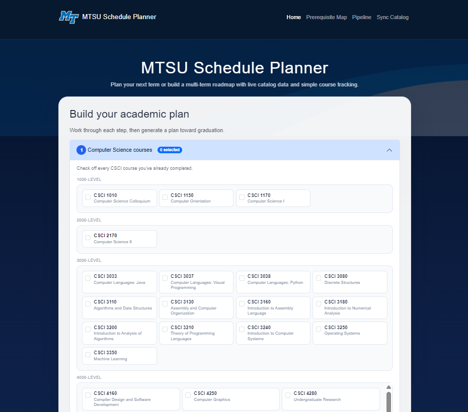
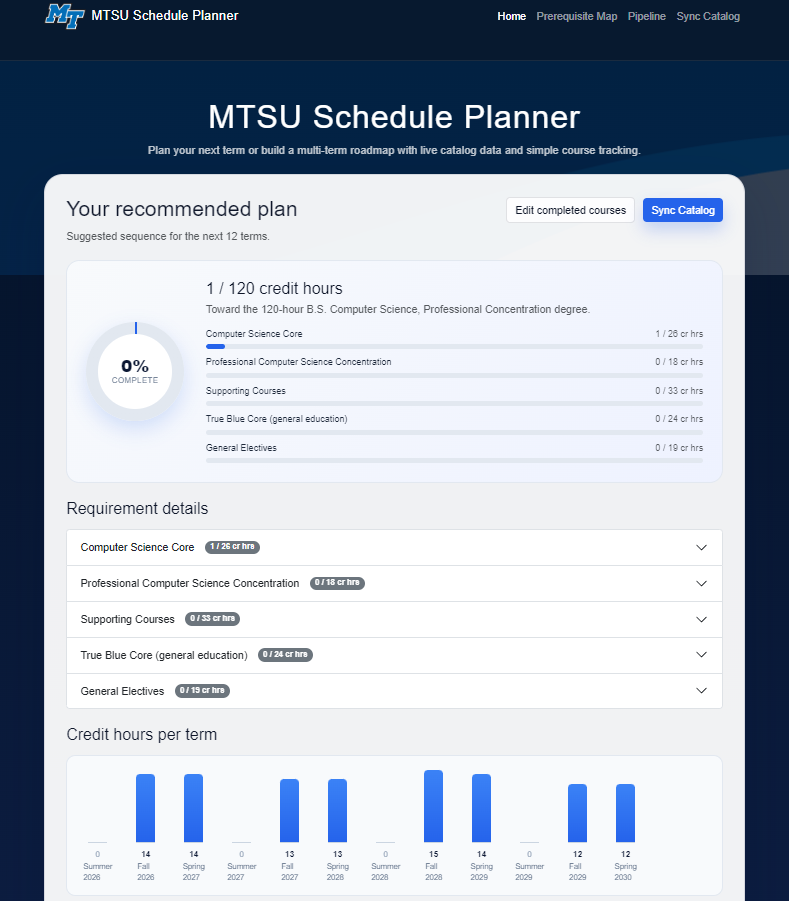
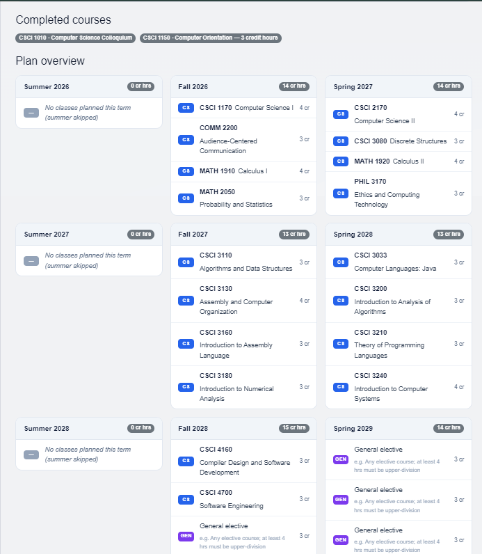
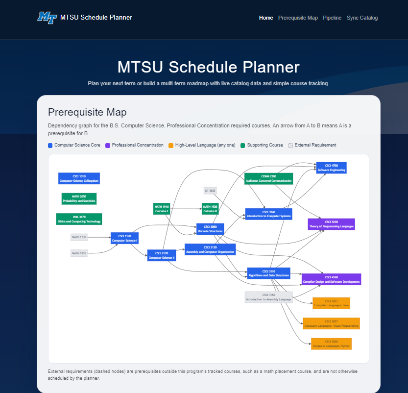

# MTSU GradPath

A degree-progress and term-planning tool for MTSU undergraduates. Pick a major (and optionally a second major or minors), check off what you've taken, and GradPath audits your progress and builds a term-by-term plan that respects prerequisites.

**Every undergraduate major and minor in the 2026-2027 MTSU catalog is supported** — 223 majors and concentrations, 152 minors, and 3,475 courses — read straight from MTSU's official catalog data rather than hand-coded.

Live demo: **https://mtsu-gradpath.onrender.com**
Video walkthrough: **https://youtu.be/ePZ4cazj3Gw**

<table width="100%" cellpadding="8">
  <tr>
    <td width="50%" valign="top" align="center">
      <br/>
      <sub><b>Course selection &amp; completed-course checklist</b></sub>
    </td>
    <td width="50%" valign="top" align="center">
      <br/>
      <sub><b>Completion progress &amp; requirement breakdown</b></sub>
    </td>
  </tr>
  <tr>
    <td width="50%" valign="top" align="center">
      <br/>
      <sub><b>Term-by-term generated schedule</b></sub>
    </td>
    <td width="50%" valign="top" align="center">
      <br/>
      <sub><b>Prerequisite dependency graph</b></sub>
    </td>
  </tr>
</table>

---

## Installation

1. Create a virtual environment and install dependencies:

   **Linux / macOS**
   ```bash
   python3 -m venv .venv && source .venv/bin/activate
   pip install -r requirements-dev.txt
   ```
   **Windows (PowerShell)**
   ```powershell
   python -m venv .venv; .venv\Scripts\Activate.ps1
   pip install -r requirements-dev.txt
   ```
   (`requirements-dev.txt` = the production `requirements.txt` plus pytest.)

2. Set a `SECRET_KEY` — **required**, `app.py` reads it via `os.environ["SECRET_KEY"]` and will not start without it:

   ```bash
   cp .env.example .env
   # edit .env and set SECRET_KEY to the output of:
   python -c "import secrets; print(secrets.token_hex(32))"
   ```

3. Run it and open `http://127.0.0.1:5000`. Course and program data ship with the repo (`catalog_data/catalog.json`), so there's no sync step:

   ```bash
   python app.py
   ```

### Running on JupyterHub

1. Upload/clone this folder into your JupyterHub home directory.
2. Open a **Terminal** (not a notebook cell) and follow steps 1–3 above exactly as on Linux.
3. JupyterHub doesn't expose `127.0.0.1:5000` directly — use the hub's proxy path instead:
   ```
   https://<your-jupyterhub-domain>/user/<your-username>/proxy/5000/
   ```
   If `jupyter-server-proxy` isn't installed on the hub, ask the instructor for the proxy URL pattern used there.

---

## Where the data comes from

MTSU's online catalog (catalog.mtsu.edu) runs on **Acalog**, which has a public *widget API* — the same one behind the embeddable widget MTSU ITD shared (`data-acalog-data="programs"`). It returns courses and full program requirement trees as JSON, **without an API key**, as long as you use the API's own catalog id:

| Catalog | id in catalog.mtsu.edu URLs (`catoid`) | id in the widget API |
|---|---|---|
| 2026-2027 Undergraduate | 49 | **12** |
| 2025-2026 Undergraduate | 45 | 9 |

Asking the API for catalog 49 returns an error, which is why we originally thought newer catalogs needed a token. They don't — `GET /widget-api/catalogs/` lists every catalog with both ids, and the exporter picks the newest published undergraduate one automatically.

**Export pipeline** (`python scrape_courses.py`):

1. `catalog_fetch.py` downloads every course and program detail (about 3,900 requests and ~40 minutes, throttled to stay under the catalog's firewall; resumable — already-downloaded items are cached in `data/raw_catalog/`).
2. `catalog_build.py` cleans it into `catalog_data/catalog.json`: each course's title, credits, prerequisites (including "A or B" choices, "must be taken concurrently" co-requisites, and minimum grades), and each program's requirement sections in catalog order.
3. The app loads that file once at startup. No scraping, database queries, or network calls happen while students use the site.

**Turning a catalog program into a plan** happens at load time in `catalog_programs.py`:

| Catalog shows | GradPath treats it as |
|---|---|
| A course on its own | Required course, scheduled by prerequisites |
| Courses joined by **OR** | One choice — any completed option counts |
| Lecture **AND** 0-credit lab | Taken together: checking the lecture counts the lab, and the planner schedules them in the same term |
| "Choose five from the following" / more courses than hours | A pool: N hours from the listed courses |
| "CSCI upper-division electives 9 credit hours" | Upper-division electives, filled with real catalog courses |
| An empty "College of Business Core (42 hours)" | Filled from the four-year academic map |
| True Blue Core | The 8 gen-ed areas (41 hrs), minus areas the major's own courses already cover |
| Top-level "Electives" | Free electives — whatever is left of the total |

Requirement rows that list courses (choices, pools, gen-ed areas) **fill in automatically** from the courses a student checks off.

Five majors keep a team-verified, hand-curated config that adds course-offering seasons (fall-only, odd-spring-only, …) and prerequisite fixes: CS Professional, Chemistry, Political and Global Affairs B.S., Aerospace Professional Pilot, and Construction Management Commercial. They're marked with a ✓ in the major picker. Their offering-season data is also used for those subjects' courses in every other program.

**Refreshing the data:**

```bash
python scrape_courses.py              # fetch anything missing, rebuild catalog_data/catalog.json
python scrape_courses.py --refresh    # start over (new catalog year)
python scrape_courses.py --build-only # rebuild from already-downloaded data
```

Commit the updated `catalog_data/catalog.json`. The **Refresh catalog data** GitHub Action does this monthly (or on demand from the Actions tab) and opens a pull request when anything changed, after running the tests against the new data.

---

## Configuration

Read via `mtsugradpath/config.py`, settable in `.env` or as shell env vars:

| Variable | Default | Description |
|---|---|---|
| `SECRET_KEY` | *(required)* | Flask session signing key |
| `DATABASE_URL` | `sqlite:///data/mtsu_courses.db` | Only holds small shared state (catalog re-export status, course equivalencies). Course data is **not** in the database. Production can keep using Supabase Postgres — see `.env.example` |
| `MTSU_CATALOG_URL` | `https://catalog.mtsu.edu` | Catalog site the exporter reads from |
| `GRADPATH_CATALOG_FILE` | *(unset)* | Load a different catalog JSON (testing) |
| `DB_POOL_SIZE` / `DB_MAX_OVERFLOW` | `3` / `2` | SQLAlchemy connection pool size per process |
| `SYNC_ADMIN_USER` / `SYNC_ADMIN_PASSWORD` | *(unset = disabled)* | HTTP Basic Auth for `/sync`, which re-exports the catalog on a running server. Without both set, `/sync` refuses every request |
| `ALLOW_OPEN_SYNC` | *(unset)* | `1` allows `/sync` without credentials — local development only |
| `SESSION_COOKIE_SECURE` | `1` on Render/Vercel, else `0` | Send the session cookie over HTTPS only |
| `FLASK_DEBUG` | *(unset)* | `1` turns on the debugger for `python app.py` (never in production) |
| `WEB_CONCURRENCY` | `3` | Gunicorn worker count (see `Procfile`) |

---

## Recent Changes

- **Every major and minor, from the official catalog** — requirements now come from MTSU's Acalog catalog data instead of hand-written configs, taking GradPath from 8 majors and 1 minor to 223 majors/concentrations and 152 minors. Each program links to its official catalog page.
- **Fast, no sync step** — the catalog ships as a JSON file loaded into memory at startup (about a quarter second). Pages render in about 4 ms on the server and are gzipped (the planner page went from ~160 KB to ~30 KB); nothing waits on the catalog website or the database. The public "Sync Catalog" button is gone.
- **Choices and gen-ed fill themselves in** — "Choose one: MATH 1530 or BIA 2610" rows and True Blue Core areas are credited from the courses a student checks off, so far fewer hours need typing in.
- **Course search covers the whole catalog** — served as a cached `/courses.json` so the planner page itself stays small.
- **Prerequisite Map for any major** — `/prerequisites?major=<key>` with a major picker.
- **Smarter prerequisites** — "A or B" prerequisites resolve to whichever option the student took or the program requires; "must be taken concurrently" courses are co-requisites; a course checked off without a grade no longer blocks the courses after it.
- **Tests for every program** — the suite plans every catalog major from scratch (and from partial progress) and checks there are no prerequisite violations and nothing gets stuck.

---

## Usage

1. Search for a major in the **Major** box (e.g. "nursing", "accounting", "CSCI"). Optionally add a second major and any number of minors. A ✓ marks the team-verified majors.
2. Check off completed courses (grouped by level). A blue dot marks courses the program requires by name; the rest are choice options and electives. Use search to add anything else in the catalog.
3. Review **Other degree requirements**: rows marked *auto* fill in from checked-off courses; enter hours for anything else.
4. Pick a starting term/year, number of terms, and whether to include summers, then **Generate Plan**.
5. Review completion progress, the per-section breakdown, the term-by-term schedule, and any prerequisite warnings. **View in catalog** links to the official program page.
6. **Prerequisite Map** in the nav bar shows the course dependency graph for any major.

Selections are kept in the browser tab's `sessionStorage` — nothing is stored server-side.

---

## Testing

```bash
python -m pytest tests
```

- `tests/test_catalog_majors.py` runs against the real exported catalog: every major plans from scratch with no prerequisite or offering warnings and every required course gets scheduled; a sample of majors also plans cleanly from random partial progress; every minor plans alongside CS; every major's page renders; plus spot checks (Accounting matches its catalog page, prerequisite map, course search, health check).
- `tests/test_catalog_build.py` covers parsing catalog text (prerequisite sentences, OR groups, concurrent courses, minimum grades, credit hours, program sections).
- `tests/test_catalog_programs.py` covers turning catalog sections into planner configs on a small made-up catalog.
- `tests/test_plan_integrity.py`, `test_planner.py`, `test_minors.py`, `test_double_major.py`, `test_form_flow.py`, `test_session_persistence.py`, `test_sync_status.py` cover the planner, audits, double majors/minors, the web form, and session handling.

GitHub Actions runs the suite on every push and pull request.

---

## Architecture

```
app.py                  Flask routes: / (form + plan), /prerequisites, /courses.json, /healthz, /sync (admin)
scrape_courses.py       CLI: export the catalog to catalog_data/catalog.json
catalog_data/
└── catalog.json        Exported catalog (courses + programs), committed to the repo
mtsugradpath/
├── catalog_fetch.py    Downloads raw courses/programs from the Acalog widget API
├── catalog_build.py    Cleans raw API data into catalog.json
├── catalog_store.py    Loads catalog.json once per process; course lookups, search index
├── catalog_programs.py Converts catalog programs into planner configs (majors + minors)
├── degree_configs.py   Team-verified configs for 8 majors + the combined major registry
├── degree.py           Degree audit (by catalog section for catalog majors)
├── minors.py           Minors: hand-written Math minor + catalog minors, minor audit
├── double_major.py     Folding a second major into a plan
├── planner.py          Term scheduling (generate_plan) + independent validation (validate_plan)
├── models.py / db.py   Small shared state (export status, course equivalencies)
└── config.py           Env configuration
templates/, static/     Jinja templates, CSS/assets
tests/                  pytest suite
.github/workflows/      Tests on push; monthly catalog refresh PR
```

**Scheduling:** `generate_plan()` fills each term toward 15 credit hours: required major/concentration courses first, then supporting courses, then requirement rows (choices, pools, gen-ed, free electives) — all gated by prerequisites and by known offering seasons. For catalog majors, the prerequisites enforced are the ones between the program's own required courses, with "A or B" resolved and cycles in the catalog's wording broken, so no course waits on something the plan never schedules. `validate_plan()` re-derives the same checks independently and surfaces warnings.

---

## Deployment

Hosted on [Render](https://render.com) (`stevenGGG23/MTSU-GradPath`, `main`, auto-deploy). Build: `pip install -r requirements.txt`. Start: see `Procfile`. Requires `SECRET_KEY`; set `SYNC_ADMIN_USER`/`SYNC_ADMIN_PASSWORD` so `/sync` isn't public. `DATABASE_URL` is optional now — without it the app uses a local SQLite file for its small bits of state, and all course data comes from the committed JSON. Vercel (`vercel.json`, `api/index.py`) works the same way.

`/healthz` reports the loaded catalog and how many majors/minors/courses it has, and returns 503 if no catalog is loaded — point the host's health check at it.

**Re-exporting on a running server** (normally you'd run `scrape_courses.py` and commit instead):

```bash
curl -u "$SYNC_ADMIN_USER:$SYNC_ADMIN_PASSWORD" -X POST -H "X-Requested-With: curl" https://<host>/sync
curl https://<host>/sync/status
```

It's POST-only and needs the `X-Requested-With` header, so another site can't trigger it with a browser's saved admin login. On Vercel it's disabled (serverless functions can't run the 40-minute export).

**Production hardening already in place:** security headers (CSP with per-request script nonces, `X-Frame-Options`, `nosniff`, HSTS over HTTPS), Subresource Integrity on the Bootstrap CDN files, a 64 KB request size limit, course-code validation on every submitted field, rate limiting keyed on the real client IP behind Render's proxy (`ProxyFix`), gzip, versioned static assets, friendly 404/413/429/500 pages, threaded gunicorn workers with a 60 s timeout (`Procfile`), and a startup that survives the database being unreachable.

---

## Known Limitations

- **Unofficial.** Requirements are read automatically from the catalog. Most programs come out within a few hours of their stated total, but some catalog layouts are ambiguous (e.g. programs whose courses also satisfy gen-ed areas without saying which). Each program links to its catalog page, and the plan page says to confirm there and with an advisor.
- **Course-offering seasons** (fall-only, etc.) are only known for the subjects covered by the team-verified configs (CSCI, BIOL, MATH, CHEM, PHYS, CMT/CCM). Everything else is assumed offered every fall and spring. The catalog doesn't publish this; it would need class-schedule data.
- **Programs with alternative "emphases"** (e.g. the Science minor) plan the first emphasis listed.
- **Course notes the catalog writes in prose** ("no more than one course from the same department", "approval of the advisor") aren't enforced.
- **Rate limiting counts per gunicorn worker**, not globally (in-memory storage).
- **Planner input only lasts for the browser tab** (`sessionStorage`). Saved plans tied to accounts are a future item.

---

## Project Background

Originated from a course proposal (Statement of Scope, July 15, 2026) under group name "Future FANG." The objective — generate an optimal graduation path from completed coursework — is unchanged; the implementation diverged from the proposal in several ways: SQLite/SQLAlchemy replaced flat JSON files, catalog data is scraped automatically instead of hand-entered, the UI is a Flask web app instead of a desktop GUI, and charts are CSS-based instead of matplotlib. See git history for the full evolution.

## Acknowledgements

- Middle Tennessee State University Undergraduate Catalog
- Flask
- SQLAlchemy
- Bootstrap
- Mermaid.js
- Render

---

## Roadmap (Fall 2026)

- ~~Cover every undergraduate major in the catalog~~ — done: 223 majors/concentrations and 152 minors from the 2026-27 catalog.
- ~~Replace the public-widget scraper~~ — done: one-time export of the full catalog through the Acalog widget API (no key needed), refreshed monthly by GitHub Actions.
- Confirm with MTSU ITD that using the public widget API this way is OK, or switch to whatever official feed ITD provides (only `catalog_fetch.py` would change).
- Course-offering terms for every subject (needs class-schedule data).
- Migrate off Render's free tier to a host that handles registration-period concurrent load.
- User guide for students/advisors.
- Pursue MTSU adoption and hosting sponsorship.

## Team

**Data/Scraper:** Abigaid Ortiz, Will Reilly, Zackary Butler
**Infrastructure/Features:** Kevin Yassa, Mina Eshak, Brett Wilt
**Hosting:** Steven Gobran
